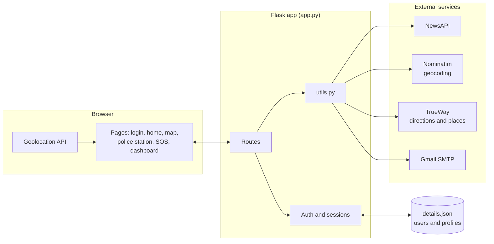
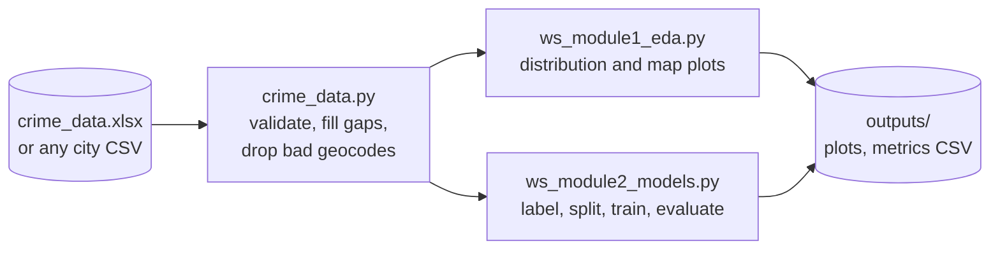
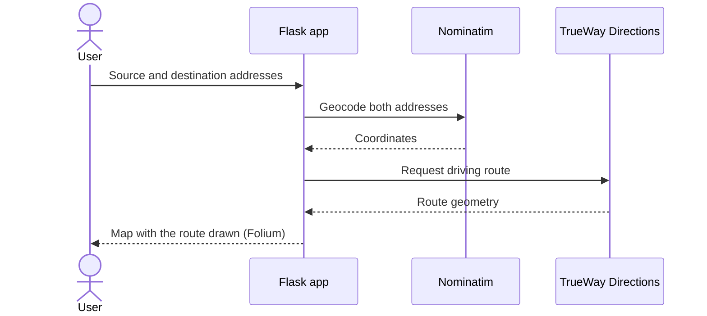
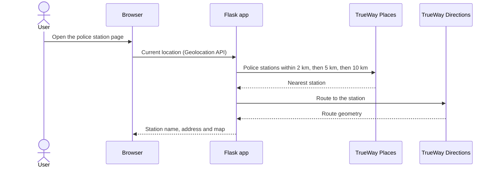
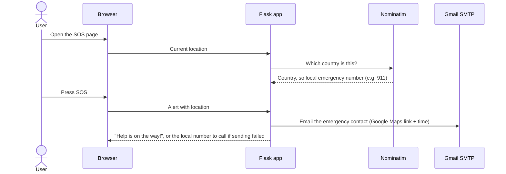

# Women Safety System

A women's safety web app that works anywhere in the world, plus a crime-data analysis that runs on any city's data. A Chennai, India dataset is included as a case study. The project has three parts:

1. **Web app (Module 3).** A Flask app with these features:
   - **Directions:** route between any two addresses worldwide, shown on a map.
   - **Nearest police station:** route from your current location. The search widens from 2 km to 10 km until it finds a station.
   - **One-tap SOS:** emails your emergency contact a Google Maps link to your location, with a timestamp.
   - **Local emergency number:** detected from your location (911 in the US, 999 in the UK, 000 in Australia, 112 across the EU and India, and so on). The SOS page shows it, so you always know whom to call.
   - **News feed:** women's-safety news on the home page.
   - **Accounts:** login, signup and a profile dashboard.
2. **Exploratory analysis (Module 1).** Plots how theft, robbery, assault and harassment are distributed across a city.
3. **Safety classification (Module 2).** Tests whether a location's coordinates alone can predict whether it has above-median crime.

## Tech stack

| Layer | Technology |
|---|---|
| Backend | Python, Flask, Werkzeug (sessions, password hashing) |
| Frontend | HTML (Jinja2 templates), CSS, vanilla JavaScript, browser Geolocation API |
| Maps | Folium (Leaflet.js) with OpenStreetMap tiles |
| Geocoding | geopy with OpenStreetMap Nominatim (addresses to coordinates, coordinates to country) |
| Routing and places | TrueWay Directions and TrueWay Places (via RapidAPI) |
| News | NewsAPI |
| Alerts | Gmail SMTP (`smtplib`) |
| Storage | JSON file (`details.json`) |
| Data analysis | pandas, NumPy, Matplotlib, seaborn |
| Machine learning | scikit-learn (Logistic Regression, Decision Tree), Keras / TensorFlow (neural network) |

## Architecture





## Workflow

### Directions



### Nearest police station



### SOS alert



### Analysis

1. **Load:** read the dataset (`.xlsx` or `.csv`) and check that the required columns exist.
2. **Clean:** fill missing numeric values with column medians, and drop rows geocoded outside the city.
3. **Explore (Module 1):** plot each crime type's distribution, a map of total crime, and the total-crime distribution.
4. **Label (Module 2):** mark each location unsafe if its total crime is above the median, otherwise safe.
5. **Train and evaluate:** fit a baseline, Logistic Regression, a Decision Tree and a neural network on latitude and longitude, then report test-set and 5-fold cross-validated metrics.

## Project structure

```
Women-s-Security-System-main/Implementation Code/
├── crime_data.xlsx              # Bundled dataset: Chennai case study (150 locations)
├── crime_data.py                # Shared loading, validation and cleaning
├── ws_module1_eda.py            # Module 1: exploratory analysis
├── ws_module2_models.py         # Module 2: models and metrics
├── requirements-analysis.txt    # Dependencies for Modules 1–2
└── Module3-20240324T090342Z-001/Module3/
    ├── app.py                   # Flask routes, auth, sessions
    ├── utils.py                 # News, geocoding, routing, maps, emergency numbers, SOS email
    ├── details.json             # User accounts (hashed passwords) and profiles
    ├── requirements.txt         # Dependencies for the web app
    ├── .env.example             # Template for API keys and secrets
    ├── templates/               # HTML pages
    └── static/                  # CSS and SVG images
```

## Running the web app

Requires Python 3.9 or newer.

```bash
cd "Women-s-Security-System-main/Implementation Code/Module3-20240324T090342Z-001/Module3"
python3 -m venv venv
source venv/bin/activate
pip install -r requirements.txt
cp .env.example .env          # then fill in the values (see below)
```

Start the app:

```bash
set -a; source .env; set +a
python app.py
```

Open http://127.0.0.1:5000, create an account, and add an emergency contact email on the **Dashboard** page.

### Configuration (`.env`)

| Variable | Purpose | How to get it |
|---|---|---|
| `FLASK_SECRET_KEY` | Signs login sessions | `python3 -c "import secrets; print(secrets.token_hex(32))"` |
| `NEWS_API_KEY` | News feed on the home page | Free key from [newsapi.org](https://newsapi.org) |
| `RAPIDAPI_KEY` | Directions and nearby police stations | [RapidAPI](https://rapidapi.com): subscribe to **TrueWay Directions** and **TrueWay Places** (free tiers) |
| `MAIL_SENDER` | Gmail account that sends SOS alerts | Any Gmail address you control |
| `MAIL_PASSWORD` | Gmail **app password** for that account | Turn on 2-Step Verification, then create one at [myaccount.google.com/apppasswords](https://myaccount.google.com/apppasswords). Paste it without spaces. |
| `FLASK_DEBUG` | Optional, default `0` | Set to `1` only on your own machine |
| `SESSION_COOKIE_SECURE` | Optional, default `0` | Set to `1` when serving over HTTPS |

`.env` is listed in `.gitignore`, so never commit it. If a key is missing, the app still starts and only the feature that needs that key fails.

## Running the analysis

```bash
cd "Women-s-Security-System-main/Implementation Code"
pip install -r requirements-analysis.txt
python ws_module1_eda.py           # plots: outputs/module1_*.png
python ws_module2_models.py        # metrics and plots: outputs/module2_*
python ws_module2_models.py --no-nn   # skip the neural network (no TensorFlow needed)
```

### Using another city's data

Both scripts accept any `.xlsx` or `.csv` file with the columns `Lat, Long, Theft, Robbery, Assault, Harassment`:

```bash
python ws_module2_models.py --data london.csv
python ws_module2_models.py --data london.csv --radius-km 30
python ws_module2_models.py --data london.csv --bbox 51.28,51.70,-0.51,0.33
```

- **`--radius-km`** keeps locations within this distance of the dataset's median location, which removes addresses geocoded to the wrong place. The default is 50 km.
- **`--bbox MIN_LAT,MAX_LAT,MIN_LONG,MAX_LONG`** sets the city area explicitly instead.

### Data cleaning (bundled Chennai dataset)

- **Bad geocodes:** 56 of the 150 rows had coordinates far outside the city, some on other continents. Anything more than 50 km from the median location is dropped, which leaves **94 locations**.
- **Missing values:** numeric columns are filled with the column median.
- **Index column:** the leftover `Unnamed: 0` index column is removed.

### Problem setup

- **Label:** a location is **unsafe (1)** if its total crime count is above the median, otherwise **safe (0)**. For Chennai the two classes are balanced, 46 unsafe to 48 safe.
- **Features:** latitude and longitude only. Crime counts are left out because the label is computed from them: an earlier version included `Total_Crimes` and reported a meaningless 100% accuracy.
- **Evaluation:** a stratified 75/25 train/test split, plus 5-fold stratified cross-validation. Cross-validation is the more reliable number, because the test set has only 24 rows.

## Metrics

Results on the bundled Chennai dataset, with "unsafe" as the positive class. The values come from `python ws_module2_models.py` with `random_state=42`, and the full table, including standard deviations, is saved to `outputs/module2_metrics.csv`.

| Model | Test accuracy | Test precision | Test recall | Test F1 | Test ROC-AUC | CV accuracy | CV F1 | CV ROC-AUC |
|---|---|---|---|---|---|---|---|---|
| Baseline (majority class) | 0.50 | 0.00 | 0.00 | 0.00 | 0.50 | 0.51 ± 0.02 | 0.00 | 0.50 |
| Logistic Regression | 0.54 | 0.53 | 0.83 | 0.65 | 0.74 | 0.56 ± 0.06 | 0.48 | 0.60 |
| Decision Tree (depth 3) | 0.50 | 0.50 | 0.58 | 0.54 | 0.57 | 0.54 ± 0.05 | 0.51 | 0.54 |
| Neural Network (10-5-1) | 0.50 | 0.50 | 0.75 | 0.60 | 0.63 | n/a* | n/a* | n/a* |

\* The neural network is not cross-validated, to keep the run time short.

**What the numbers say:** in this dataset, location alone is a weak predictor of crime level. Logistic regression does best, with a cross-validated ROC-AUC of 0.60, but every model is only slightly better than the baseline. The single test split also looks better than the cross-validation results (for example, a test ROC-AUC of 0.74 against a cross-validated 0.60), which shows how noisy a 24-row test set is.

**Ways to improve the models:**
- Fix the geocoding so the 56 dropped rows can be used.
- Collect more labelled locations.
- Add location features that matter for safety, such as distance to the nearest police station, street lighting and footfall.
